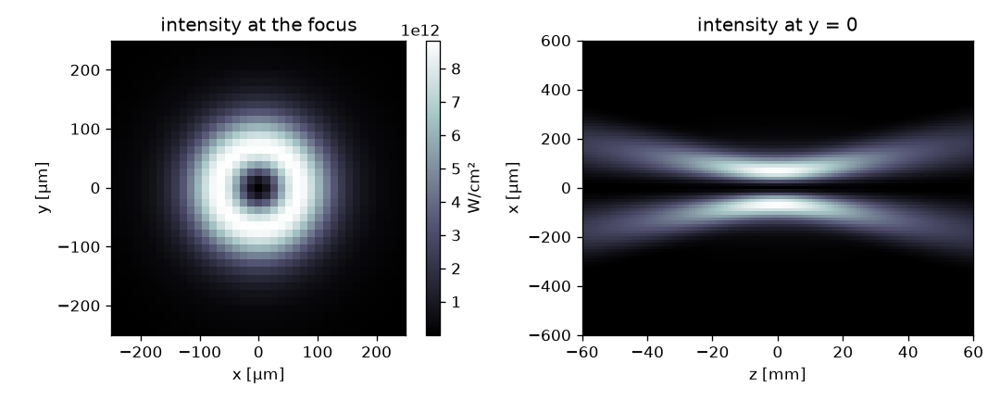

# fourierslm

[](https://github.com/melvinrdn/fourierslm/actions/workflows/ci.yml)
[](https://melvinrdn.github.io/fourierslm)

Fourier optics of a phase-only SLM: the beam on the SLM, its phase pattern, and the field it makes in the focal region
of a lens, in physical units.

**Documentation:** https://melvinrdn.github.io/fourierslm

## Install

```bash
pip install fourierslm    # or: uv add fourierslm
```

## Example

A Gaussian pulse of 1 mJ and 200 fs on a square of 10 beam radii, a vortex of charge 1, and a lens of 50 cm placed
30 cm after the SLM. With the peak power, |E|² is the peak intensity in every plane. `focus` gives the field in the
back focal plane, the Fourier transform of the field on the SLM, on the part of the focal grid kept around the axis.
`free` then propagates it through the focus.

```python
import matplotlib.pyplot as plt
import numpy as np

import fourierslm as fs

lam, f, w = 1030e-9, 0.5, 2e-3
X, Y = fs.slm_grid(size=10 * w)  # 2048 × 2048 points
x, y = fs.focus_grid(X, Y, lam, f)

intensity = fs.intensity.gaussian(X, Y, w, power=fs.peak_power(energy=1e-3, duration=200e-15))  # W/m²
phase = fs.phase.vortex(X, Y, charge=1)
E_slm = fs.slm_field(intensity, phase)

x = y = x[np.abs(x) < 1.5e-3]  # keep ±1.5 mm around the axis
E_focus = fs.propagate.focus(E_slm, X, Y, x, y, lam, f, slm_distance=0.3)  # back focal plane
z = np.linspace(-60e-3, 60e-3, 121)
I = np.abs(fs.propagate.free(E_focus, x[1] - x[0], lam, z)) ** 2  # W/m², shape (len(z), len(x), len(x))

fig, ax = plt.subplots(1, 2, figsize=(9, 3.6))
c = len(x) // 2
im = ax[0].imshow(I[60] * 1e-4, extent=[x[0] * 1e6, x[-1] * 1e6] * 2, origin="lower", cmap="bone")
ax[0].set(xlabel="x [µm]", ylabel="y [µm]", title="intensity at the focus", xlim=(-250, 250), ylim=(-250, 250))
fig.colorbar(im, ax=ax[0], label="W/cm²")
ax[1].imshow(
    I[:, c, :].T * 1e-4,
    extent=[z[0] * 1e3, z[-1] * 1e3, x[0] * 1e6, x[-1] * 1e6],
    origin="lower",
    aspect="auto",
    cmap="bone",
)
ax[1].set(xlabel="z [mm]", ylabel="x [µm]", title="intensity at y = 0", ylim=(-600, 600))
fig.tight_layout()
plt.show()
```



## License

MIT
